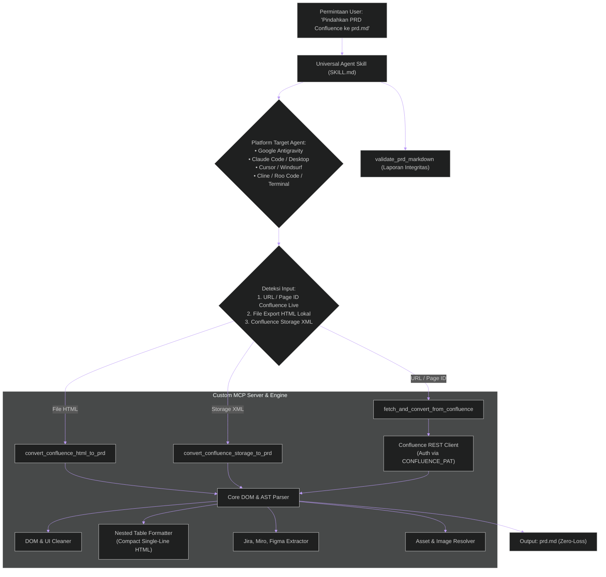

<div align="center">

# 📑 Confluence PRD Converter

**Universal AI Agent Skill & Custom MCP Server untuk Konversi Otomatis PRD Confluence Menjadi Markdown (`prd.md`) Standar Produksi (Zero-Loss)**

[](https://modelcontextprotocol.io/)
[](https://python.org)
[](https://github.com/hanifalkauni/confluence-prd-converter)
[](LICENSE)

[English](README.md) • [Bahasa Indonesia](README.id.md)

</div>

---

## 🌟 Latar Belakang & Masalah

Dalam siklus pengembangan produk (*product engineering*), dokumen **PRD (*Product Requirement Document*)** di Confluence memuat elemen yang sangat kompleks:
- **Macro Jira Issue** dengan lozenge status dinamis (`IN PROGRESS`, `DONE`, `BACKLOG`)
- **Tabel bersarang (*nested tables*)** untuk *User Story Acceptance Criteria*, *Master Config*, dan matriks *Data Tracking*
- **Embed widget interaktif** dari Figma dan Miro
- **Puluhan mockup/diagram visual**
- **Matriks keamanan** (ITPF / STRIDE Threat Modeling)

Saat memindahkan PRD ke format Markdown secara manual atau konverter biasa:
1. ❌ **Tabel Rusak (*Broken Tables*)**: Markdown standar tidak mendukung tabel di dalam sel tabel.
2. ❌ **Hilangnya Metadata**: Macro Jira dan status badge terhapus atau menjadi tag HTML kotor.
3. ❌ **Link Embed Rusak**: Iframe Figma dan Miro tidak terekstrak menjadi URL yang dapat diklik.
4. ❌ **Path Gambar Putus**: Gambar tidak terhubung dengan folder aset lokal.
5. ❌ **Inefisiensi Agent**: AI Agent harus membuat skrip *scratch* berulang kali setiap ada tugas konversi.

**`confluence-prd-converter`** hadir dengan menggabungkan **FastMCP Server Terbuka** dan **Universal Agent Skill** yang dapat langsung mengeksekusi konversi berkualitas tinggi hanya dalam 1 kali perintah pada AI Agent mana pun.

---

## 🏗️ Arsitektur & Alur Eksekusi



---

## ✨ Fitur Unggulan & Standar Kualitas

### 1. 📊 Penanganan Tabel Bersarang (*Nested Tables*)
Sub-tabel di dalam sel tabel dikonversi menjadi tag HTML `<table>` mini dalam satu baris dengan *line-break* yang diubah menjadi `<br>`, menjaga struktur pemisah baris tabel Markdown luar tetap utuh.

### 2. 🎫 Ekstraksi Macro & Lozenge Jira
Mengambil key, judul issue, link URL, dan status lozenge:
```markdown
• [CITA-1042](https://jira.../browse/CITA-1042) - Profile Revamp `IN PROGRESS`
```

### 3. 🎨 Ekstraksi Embed Figma & Miro
Mengekstrak URL asli dari tag `<iframe>`:
```markdown
[Figma Design](https://www.figma.com/file/...)
[Miro Board](https://miro.com/app/board/...)
```

### 4. 🖼️ Pemetaan Aset & Filter Icon Sistem
Otomatis mengunduh lampiran pada mode live atau memetakan folder aset lokal `./[nama]_files/` sekaligus menyaring icon sistem kecil (`epic.svg`, `viewavatar`, `default.svg`).

### 5. 💡 Panel Callout GitHub Alerts
Mengubah panel info, peringatan, tips, dan catatan Confluence menjadi format alert GitHub:
```markdown
> [!NOTE]
> **Status Dokumen**
> PRD ini sedang dalam tahap review aktif oleh tim frontend.
```

### 6. 💬 Ekstraksi Diskusi & Komentar Halaman
Mengambil komentar reviewer, catatan InfoSec, dan klarifikasi arsitektur secara otomatis ke dalam section `## 💬 Discussions & Page Comments` lengkap dengan badge pengirim, timestamp UTC, dan blockquote.

---

## 🛠️ Daftar Tools MCP

| Nama Tool | Deskripsi | Parameter Utama |
| :--- | :--- | :--- |
| `fetch_and_convert_from_confluence` | Mengambil PRD secara live via URL atau Page ID Confluence, mengunduh gambar lampiran, mengekstrak komentar, dan menghasilkan `prd.md`. | `page_id_or_url`, `output_md_path`, `download_images`, `include_comments`, `assets_folder_name` |
| `convert_confluence_html_to_prd` | Mengonversi file export `.html` lokal Confluence ke format Markdown terstruktur. | `html_file_path`, `output_md_path`, `preserve_nested_tables`, `assets_folder_name` |
| `convert_confluence_storage_to_prd` | Mengonversi raw XML/XHTML Storage Format (`body.storage.value`) langsung ke Markdown. | `storage_xml_content`, `output_md_path`, `assets_folder_name` |
| `validate_prd_markdown` | Memeriksa integritas `prd.md` (tabel, link gambar, macro unparsed) dan menghasilkan metrik. | `md_file_path` |

---

## 🔌 Panduan Setup Multi-Agent

### 💬 Metode A: Universal MCP Server (Direkomendasikan untuk Tool Calling)

Tambahkan `confluence-prd-converter` langsung ke AI IDE Anda (Google Antigravity, Claude Desktop, Cursor, Windsurf, Cline, Continue.dev, Kiro) via MCP:

```json
{
  "mcpServers": {
    "confluence-prd-converter": {
      "command": "npx",
      "args": [
        "-y",
        "github:hanifalkauni/confluence-prd-converter",
        "--mcp"
      ],
      "env": {
        "CONFLUENCE_URL": "https://wiki.yourcompany.com",
        "CONFLUENCE_PAT": "TOKEN_PAT_ANDA"
      }
    }
  }
}
```

---

### 📄 Metode B: Pure Skill Agent / Rule File (Tanpa Server MCP)

Jika Anda ingin memasang instruksi skill/rule langsung ke workspace proyek untuk penalaran *native* AI agent:

#### 🌐 Opsi 1: Otomatis via skills.sh (Direkomendasikan — 30+ AI Agents)
Pasang hanya dengan 1 perintah langsung ke Cursor, Claude Code, Windsurf, Copilot, atau Gemini CLI:
```bash
npx skills add hanifalkauni/confluence-prd-converter
```

#### ⚡ Opsi 2: Inisialisasi Adapter Otomatis via CLI
Ekspor seluruh file rule adapter agent ke root workspace proyek Anda:
```bash
npx -y github:hanifalkauni/confluence-prd-converter init
```

#### 📦 Opsi 3: Pemasangan Manual per AI Agent

<details>
<summary><b>🤖 Google Antigravity & Gemini CLI</b></summary>

Salin adapter ke direktori skill workspace:
```bash
mkdir -p .agents/skills/confluence-prd-converter
cp adapters/antigravity/SKILL.md .agents/skills/confluence-prd-converter/SKILL.md
```
*Atau pasang secara global untuk semua workspace di:* `~/.gemini/config/skills/confluence-prd-converter/SKILL.md`.

</details>

<details>
<summary><b>🧠 Claude Code & Claude Desktop</b></summary>

Tambahkan ke root proyek `CLAUDE.md`:
```bash
cp adapters/claude/CLAUDE.md ./CLAUDE.md
```

</details>

<details>
<summary><b>⚡ Cursor IDE</b></summary>

Tambahkan file rule ke `.cursor/rules/`:
```bash
mkdir -p .cursor/rules
cp adapters/cursor/confluence-prd-converter.mdc .cursor/rules/confluence-prd-converter.mdc
```

</details>

<details>
<summary><b>🌊 Windsurf IDE</b></summary>

Tambahkan rule ke `.windsurf/rules/`:
```bash
mkdir -p .windsurf/rules
cp adapters/windsurf/windsurfrules.md .windsurf/rules/confluence-prd-converter.md
```

</details>

<details>
<summary><b>🤖 Cline & Roo Code</b></summary>

Tambahkan rule ke `.clinerules/`:
```bash
mkdir -p .clinerules
cp adapters/cline/clinerules.md .clinerules/confluence-prd-converter.md
```

</details>

<details>
<summary><b>🐙 GitHub Copilot</b></summary>

Tambahkan ke `.github/copilot-instructions.md`:
```bash
mkdir -p .github
cp adapters/copilot/copilot-instructions.md .github/copilot-instructions.md
```

</details>

<details>
<summary><b>🎯 Kiro</b></summary>

Tambahkan steering instructions ke `.kiro/steering/`:
```bash
mkdir -p .kiro/steering
cp adapters/kiro/steering.md .kiro/steering/confluence-prd-converter.md
```

</details>

<details>
<summary><b>⏩ Continue.dev</b></summary>

Tambahkan prompt rule ke `.continue/rules/`:
```bash
mkdir -p .continue/rules
cp adapters/continue/prompt.md .continue/rules/confluence-prd-converter.md
```

</details>

---

### 💻 Metode C: Runner CLI Terminal Mandiri

Konversi file export HTML lokal:
```bash
npx -y github:hanifalkauni/confluence-prd-converter --input ./PRD_Export.html --output ./prd.md
```

Fetch live dari URL Confluence:
```bash
npx -y github:hanifalkauni/confluence-prd-converter --input "https://wiki.yourcompany.com/pages/viewpage.action?pageId=1766097385" --output ./prd.md
```

Validasi integritas markdown:
```bash
python scripts/validate_output.py --input ./prd.md
```

---

## 📂 Struktur Repositori

```
confluence-prd-converter/
├── server.py                        # Server FastMCP (stdio JSON-RPC untuk AI IDE)
├── SKILL.md                         # Definisi Master Universal Agent Skill
├── core/                            # Engine utama parsing & transformasi
│   ├── confluence_client.py         # REST API client & attachment/comment fetcher
│   ├── parser.py                    # Unified AST parser (Storage XML & View HTML)
│   ├── formatters.py                # Nested table compact HTML, Jira lozenges, alert callouts
│   ├── clean.py                     # DOM sanitizer & filter icon sistem
│   └── validator.py                 # Validator integritas struktur Markdown
├── adapters/                        # Rule & skill adapter untuk 8+ AI Agent IDE
│   ├── antigravity/                 # Google Antigravity & Gemini CLI
│   ├── claude/                      # Claude Code & Claude Desktop
│   ├── cursor/                      # Cursor IDE (.cursor/rules/)
│   ├── windsurf/                    # Windsurf Cascade (.windsurf/rules/)
│   ├── cline/                       # Cline & Roo Code (.clinerules/)
│   ├── copilot/                     # GitHub Copilot (.github/)
│   ├── kiro/                        # Kiro Steering (.kiro/steering/)
│   └── continue/                    # Continue.dev (.continue/rules/)
├── evaluations/                     # Evaluation & Feedback Hub (RFC & studi kasus)
├── scripts/                         # Skrip CLI mandiri (run_converter, validate_output)
├── tests/                           # Unit test suite & fixture sample general
├── schema.json                      # JSON Schema konfigurasi
└── confluence-prd-converter.config.json # File konfigurasi proyek
```

---

## 🧪 Pengujian & Verifikasi

Jalankan seluruh test suite unit test:

```bash
python tests/test_all.py
```

---

## 📄 Lisensi

SPDX-License-Identifier: [MIT](LICENSE)

Proyek ini dirilis di bawah lisensi [MIT License](LICENSE).
