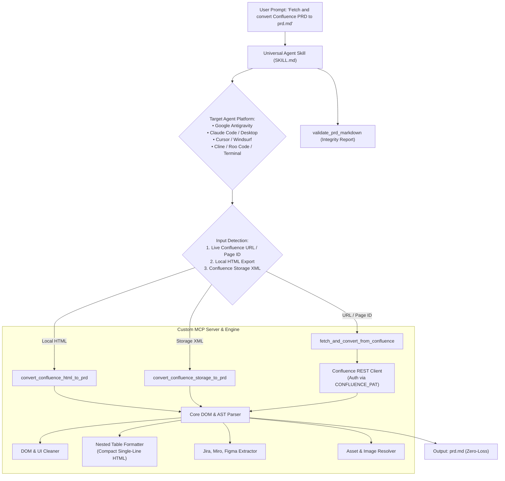

<div align="center">

# 📑 Confluence PRD Converter

**Universal AI Agent Skill & Custom MCP Server for Automated, Zero-Loss Confluence PRD Conversion to Production Markdown (`prd.md`)**

[](https://modelcontextprotocol.io/)
[](https://python.org)
[](https://github.com/hanifalkauni/confluence-prd-converter)
[](LICENSE)

[English](README.md) • [Bahasa Indonesia](README.id.md)

</div>

---

## 🌟 Overview & Problem Statement

In agile software development, **PRD (Product Requirement Document)** pages in Confluence contain complex, multi-layered information:
- **Jira Issue macros** with dynamic status lozenges (`IN PROGRESS`, `DONE`, `BACKLOG`)
- **Nested tables** (tables inside cells for acceptance criteria, data tracking schemas, and master config)
- **Embedded interactive prototypes** from Figma and Miro
- **Dozens of mockup diagrams** and architecture screenshots
- **Security matrices** (ITPF / STRIDE Threat Modeling)

When exporting or migrating these documents to standard Markdown manually or via basic converters:
1. ❌ **Broken Tables**: Markdown lacks native nested table syntax; cell linebreaks shatter outer table rows.
2. ❌ **Lost Metadata**: Jira lozenges and macros turn into ugly HTML tags or disappear.
3. ❌ **Unclickable Embeds**: Figma and Miro iframes fail to extract clean URLs.
4. ❌ **Broken Assets**: Image links fail to resolve to local asset directories.
5. ❌ **Repetitive Scratch Scripts**: Agents spend valuable context windows repeatedly writing Python scripts for conversion.

**`confluence-prd-converter`** solves this permanently by combining an **Open FastMCP Server** and a **Universal Agent Skill** that execute zero-loss, deterministic conversions in a single prompt across any AI assistant.

---

## 🏗️ Architecture & Execution Flow



---

## ✨ Key Capabilities & Zero-Loss Standards

### 1. 📊 Compact Nested Table Engine
Sub-tables inside table cells are converted into compact single-line HTML `<table>` elements with inner linebreaks converted to `<br>`, preserving strict Markdown table rows.

### 2. 🎫 Jira Macro & Lozenge Resolution
Extracts Jira keys, summaries, URLs, and status badges into clean Markdown:
```markdown
• [CITA-1042](https://jira.../browse/CITA-1042) - Profile Revamp `IN PROGRESS`
```

### 3. 🎨 Figma & Miro Embed Extraction
Decodes complex iframe source URLs to direct links:
```markdown
[Figma Design](https://www.figma.com/file/...)
[Miro Board](https://miro.com/app/board/...)
```

### 4. 🖼️ Smart Asset Mapping & Icon Filtering
Automatically downloads attachments from live pages or maps local `./[name]_files/` directories while stripping noisy system icons (`epic.svg`, `viewavatar`, `default.svg`).

### 5. 💡 GitHub Alert Panels
Transforms Confluence info/warning/note/tip panels into standard GitHub callouts:
```markdown
> [!NOTE]
> **Document Status**
> This PRD is currently under active review.
```

### 6. 💬 Discussion & Comment Extraction
Automatically captures stakeholder feedback, reviewer comments, and architectural decisions into a structured `## 💬 Discussions & Page Comments` section, preserving author names, timestamps, user mentions, and formatting.

---

## 🛠️ MCP Tool Reference

| Tool Name | Description | Key Parameters |
| :--- | :--- | :--- |
| `fetch_and_convert_from_confluence` | Live fetch from Confluence by URL or Page ID, downloads image attachments, extracts comments, and outputs `prd.md`. | `page_id_or_url`, `output_md_path`, `download_images`, `include_comments`, `assets_folder_name` |
| `convert_confluence_html_to_prd` | Converts local Confluence exported `.html` file to structured Markdown. | `html_file_path`, `output_md_path`, `preserve_nested_tables`, `assets_folder_name` |
| `convert_confluence_storage_to_prd` | Converts raw XML/XHTML Storage Format (`body.storage.value`) directly to Markdown. | `storage_xml_content`, `output_md_path`, `assets_folder_name` |
| `validate_prd_markdown` | Inspects `prd.md` for broken tables, missing images, unparsed tags, and compiles statistics. | `md_file_path` |

---

## 🔌 Multi-Agent Integration Guide

### 💬 Method A: Universal MCP Server (Recommended for Tool Calling)

Add `confluence-prd-converter` directly to your AI IDE (Google Antigravity, Claude Desktop, Cursor, Windsurf, Cline, Continue.dev, Kiro) via MCP:

```json
{
  "mcpServers": {
    "confluence-prd-converter": {
      "command": "npx",
      "args": [
        "-y",
        "github:hanifalkauni/confluence-prd-converter",
        "--mcp"
      ],
      "env": {
        "CONFLUENCE_URL": "https://wiki.yourcompany.com",
        "CONFLUENCE_PAT": "YOUR_PERSONAL_ACCESS_TOKEN"
      }
    }
  }
}
```

---

### 📄 Method B: Pure Skill Agent / Rule File (No MCP Server Required)

If you prefer installing the skill instructions directly into your workspace for native agent reasoning:

#### 🌐 Option 1: Automatic via skills.sh (Recommended — 30+ AI Agents)
Install with a single command into Cursor, Claude Code, Windsurf, Copilot, or Gemini CLI:
```bash
npx skills add hanifalkauni/confluence-prd-converter
```

#### ⚡ Option 2: Automatic Adapter Injection via CLI
Export all agent adapter files into your current workspace root:
```bash
npx -y github:hanifalkauni/confluence-prd-converter init
```

#### 📦 Option 3: Manual Installation per AI Agent

<details>
<summary><b>🤖 Google Antigravity & Gemini CLI</b></summary>

Copy adapter to local workspace skill directory:
```bash
mkdir -p .agents/skills/confluence-prd-converter
cp adapters/antigravity/SKILL.md .agents/skills/confluence-prd-converter/SKILL.md
```
*Or install globally for all workspaces at:* `~/.gemini/config/skills/confluence-prd-converter/SKILL.md`.

</details>

<details>
<summary><b>🧠 Claude Code & Claude Desktop</b></summary>

Add to project root `CLAUDE.md`:
```bash
cp adapters/claude/CLAUDE.md ./CLAUDE.md
```

</details>

<details>
<summary><b>⚡ Cursor IDE</b></summary>

Add rule file to `.cursor/rules/`:
```bash
mkdir -p .cursor/rules
cp adapters/cursor/confluence-prd-converter.mdc .cursor/rules/confluence-prd-converter.mdc
```

</details>

<details>
<summary><b>🌊 Windsurf IDE</b></summary>

Add rule to `.windsurf/rules/`:
```bash
mkdir -p .windsurf/rules
cp adapters/windsurf/windsurfrules.md .windsurf/rules/confluence-prd-converter.md
```

</details>

<details>
<summary><b>🤖 Cline & Roo Code</b></summary>

Add rule to `.clinerules/`:
```bash
mkdir -p .clinerules
cp adapters/cline/clinerules.md .clinerules/confluence-prd-converter.md
```

</details>

<details>
<summary><b>🐙 GitHub Copilot</b></summary>

Add to `.github/copilot-instructions.md`:
```bash
mkdir -p .github
cp adapters/copilot/copilot-instructions.md .github/copilot-instructions.md
```

</details>

---

### 💻 Method C: Standalone Terminal CLI Runner

Convert local HTML export:
```bash
npx -y github:hanifalkauni/confluence-prd-converter --input ./PRD_Export.html --output ./prd.md
```

Live fetch from Confluence URL:
```bash
npx -y github:hanifalkauni/confluence-prd-converter --input "https://wiki.yourcompany.com/pages/viewpage.action?pageId=1766097385" --output ./prd.md
```

Validate markdown integrity:
```bash
python scripts/validate_output.py --input ./prd.md
```

---

## 🧪 Testing & Verification

Run the full unit test suite:

```bash
python tests/test_all.py
```

---

## 📄 License

This project is licensed under the [MIT License](LICENSE).
