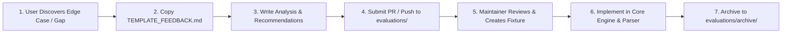

# 📋 Evaluation & Feedback Hub — Confluence PRD Converter

<p align="center">
  <a href="#-english"><b>English</b></a> •
  <a href="#-bahasa-indonesia"><b>Bahasa Indonesia</b></a>
</p>

---

## 🌐 English

Welcome to the **Evaluation & Feedback Hub** of `confluence-prd-converter`. This directory serves as a structured collaboration bridge between community users (*product managers, software engineers, AI agents*) and project maintainers.

When using `confluence-prd-converter` on enterprise Confluence spaces and encountering complex pages where layouts break, custom macros are unparsed, or discussions/comments are omitted, you can document and submit your evaluation here.

### 🔄 Evaluation Workflow



#### 1. For Users & Contributors:
1. Copy the evaluation template [`TEMPLATE_FEEDBACK.md`](./TEMPLATE_FEEDBACK.md).
2. Name your proposal file descriptively, for example:
   - `evaluations/FEEDBACK_LUCIDCHART_MACRO_FLOW.md`
   - `evaluations/FEEDBACK_CUSTOM_SECURITY_MATRIX_TABLE.md`
3. Fill out the sections (Executive Summary, Confluence Input Snippet vs Current Output, Expected Output, Tuning Recommendations).
4. Submit a Pull Request (PR) or open an issue referencing the file.

#### 2. For Maintainers:
1. Review the incoming evaluation document and analyze the gap.
2. Build a representative test fixture in `tests/` using the sanitized sample.
3. Apply required transformations in `core/parser.py`, `core/formatters.py`, or `core/clean.py`.
4. Run `python tests/test_all.py` to verify 100% test pass rate.
5. Move the fulfilled evaluation proposal into [`evaluations/archive/`](./archive/).

---

## 🇮🇩 Bahasa Indonesia

Selamat datang di **Evaluation & Feedback Hub** `confluence-prd-converter`. Direktori ini berfungsi sebagai jembatan kolaborasi terstruktur antara pengguna komunitas (*engineer, PM, AI agents*) dan maintainer proyek.

Jika Anda menemukan halaman Confluence dengan layout unik, macro kustom yang belum terurai sempurna, atau struktur tabel kompleks yang perlu penyesuaian, Anda dapat mendokumentasikannya di sini.

### 📂 Struktur Direktori

```
evaluations/
├── README.md                   # Panduan dwibahasa ini
├── TEMPLATE_FEEDBACK.md        # Template RFC untuk mengajukan evaluasi
└── archive/                    # Arsip evaluasi yang telah diselesaikan
    └── CASE_01_RETAILER_WRAPPED_PRD.md # Studi kasus PRD enterprise nyata
```
